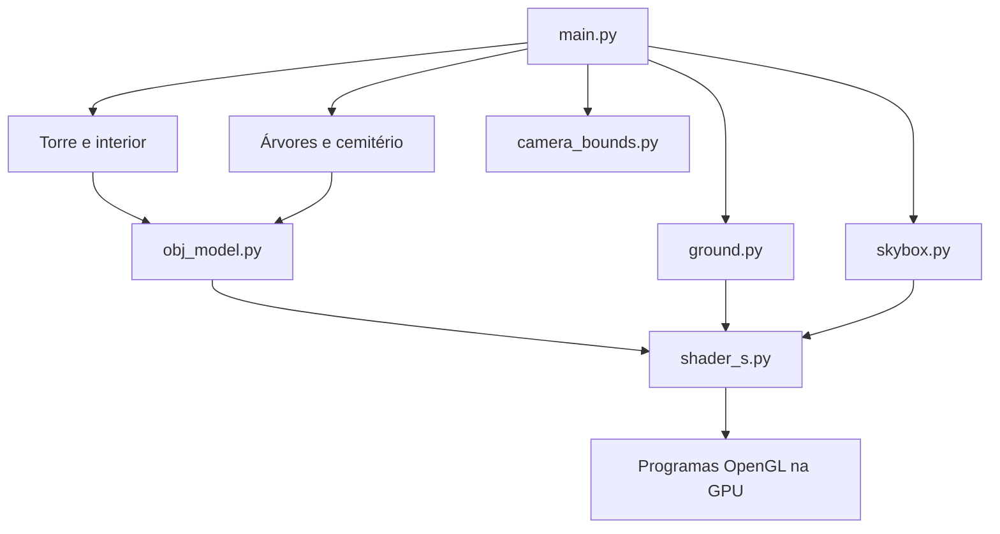

# Torre, ritual e cemitério — Computação Gráfica

Este projeto constrói uma cena 3D interativa em Python e OpenGL: uma torre em um terreno de grama, cercada por carvalhos e com um cemitério atrás. Dentro da torre, uma bruxa observa um círculo de invocação que gira continuamente. Toadbert, um mago com aparência de sapo, flutua sobre o círculo e pode crescer ou diminuir. Uma estátua Weeping Angel percorre uma órbita ao redor da torre.

Este documento serve como guia de execução, leitura do código e preparação para a apresentação. Os valores abaixo correspondem à configuração atual.

## 1. Como executar

É necessário ter Python e um ambiente gráfico com suporte a OpenGL 3.3 ou superior. O programa usa uma janela GLFW; não é uma aplicação para navegador.

Na pasta do projeto:

```powershell
python -m venv .venv
.\.venv\Scripts\python.exe -m pip install glfw PyOpenGL numpy PyGLM Pillow
.\.venv\Scripts\python.exe main.py
```

Também é possível usar um ambiente Python já configurado com essas dependências e executar `python main.py`. Os modelos e suas imagens devem permanecer nas pastas indicadas abaixo.

| Biblioteca | Responsabilidade |
| --- | --- |
| GLFW | Janela, contexto OpenGL, teclado, mouse e relógio |
| PyOpenGL | Acesso às funções de renderização e aos recursos da GPU |
| NumPy | Vetores de dados, matrizes, limites dos modelos e cálculos numéricos |
| PyGLM | Transformações, perspectiva e câmera com `lookAt` |
| Pillow | Leitura, conversão e orientação das imagens |

O primeiro carregamento pode demorar: o anjo e Toadbert têm malhas relativamente grandes, que precisam ser lidas e enviadas para a GPU.

## 2. Controles e demonstração

| Controle | Ação |
| --- | --- |
| W / S | Avança ou recua na direção em que a câmera olha |
| A / D | Desloca a câmera lateralmente |
| Mouse | Altera a direção de observação |
| Roda do mouse | Altera o campo de visão, entre 1° e 45° |
| E | Alterna o crescimento e a redução de Toadbert |
| Esc | Fecha a aplicação |

O cursor fica capturado pela janela. Como W e S acompanham a direção completa da câmera, olhar para cima ou para baixo também permite variar a altitude. A movimentação atual usa eventos de pressionamento/repetição de teclas e o intervalo entre quadros; sua sensação de velocidade também depende da repetição do teclado. O fator de velocidade está em `key_event`, em `main.py`, atualmente `200 * deltaTime`.

Para apresentar, comece pela visão frontal da torre, aproxime-se da entrada e observe o ritual. Pressione E para mostrar o crescimento; pressione novamente para mostrar a redução ou a inversão durante a transição. Depois contorne a torre para mostrar as lápides, as árvores e o anjo em movimento.

## 3. Elementos e organização espacial

O sistema de coordenadas usa **Y como altura**, X como direção lateral e Z como profundidade. A câmera começa em `(0, 5, 3)` e olha para Z negativo. Por isso, atrás da torre significa uma posição com Z ainda mais negativo.

| Elemento | Configuração atual |
| --- | --- |
| Chão | Quadrado de 200 × 200 unidades, em Y = −2 |
| Grama | Textura BaseColor repetida a cada 4 unidades |
| Torre | Centro horizontal `(0, −30)`, altura de 16 unidades |
| Círculo | Largura de 3,2 unidades, centralizado dentro da torre e ligeiramente acima do chão |
| Bruxa | Altura de 2,8 unidades, ao lado do círculo, voltada para ele |
| Toadbert | Base flutuante em Y = −1,35; altura entre 0,35 e 2,8 unidades |
| Carvalhos | 24 grupos; o OBJ contém três árvores por grupo |
| Cemitério | 12 lápides em três fileiras, atrás da torre |
| Anjo | Altura de 3,2 unidades, órbita de raio 10 ao redor da torre |
| Fundo | Cubemap carregado de `imagens/Skybox.png` |

As árvores variam em tamanho, rotação e posição, mantendo uma clareira central. As lápides têm pequenas variações e deixam um corredor entre as colunas centrais. As sementes aleatórias fixas tornam a distribuição reproduzível: a cena mantém a mesma organização em cada execução.

## 4. Estrutura do projeto

```text
main.py                 Inicialização, controles e laço principal
obj_model.py            Carregador OBJ/MTL e renderização compartilhada
shader_s.py             Leitura, compilação e ativação dos sombreadores
tower.py                Configuração da torre
tower_interior.py       Ritual, orientação da bruxa e animações internas
oak_trees.py            Distribuição dos carvalhos
graveyard.py            Distribuição das lápides e órbita do anjo
ground.py               Geometria e textura do chão
skybox.py               Recorte do cubemap e renderização do fundo
camera_bounds.py        Restrição espacial da câmera
castle.py               Alternativa de castelo preservada
shaders/                Sombreadores de modelos, chão e skybox
objetos/
    tower/
    witch/
    demoncircle/
    toadbert_the_wizard/
    oak_trees/
    graveyard_stone/
    weeping_angel/
    fantastic_castle/   Modelo alternativo preservado
grass/                  Texturas do terreno
imagens/                Imagem do cubemap
SKYBOX.md               Explicação adicional do fundo
```

Cada modelo permanece junto de seu MTL e de suas imagens, preservando os caminhos relativos. Mario e dragão foram removidos. A grama e o cubemap são imagens do ambiente, mantidas em `grass` e `imagens`.

`vertex_shader.vs`, `fragment_shader.fs` e `shaders/castle.*` são arquivos anteriores preservados; a cena atual usa `shaders/model.*`, `shaders/ground.*` e `shaders/skybox.*`.



## 5. O que acontece em cada quadro

`main.py` cria a janela, ativa o contexto OpenGL e instancia os módulos. O contexto precisa existir antes de criar texturas, programas e buffers da GPU.

O laço principal executa esta sequência:

1. Lê o relógio e calcula `deltaTime`, o tempo decorrido desde o quadro anterior.
2. Processa os eventos de entrada com `glfw.poll_events()`.
3. Restringe a câmera e atualiza o ritual e a órbita do anjo.
4. Limpa os buffers de cor e profundidade.
5. Calcula as matrizes de visão e projeção.
6. Desenha torre, interior, árvores, cemitério, chão e skybox.
7. Troca os buffers da janela com `glfw.swap_buffers()`.

O teste de profundidade permite que uma superfície próxima esconda uma distante, mesmo que a ordem de desenho dos objetos opacos varie. A skybox é desenhada por último, sem sobrescrever a profundidade dos objetos.

Ao encerrar, os métodos `close()` liberam buffers, texturas, VAOs e programas antes de `glfw.terminate()` destruir o contexto.

## 6. Como um arquivo OBJ vira um objeto na tela

### Leitura da malha e dos materiais

`load_obj`, em `obj_model.py`, interpreta estas entradas:

| Entrada | Significado |
| --- | --- |
| `v` | Posição XYZ; opcionalmente, cor RGB do vértice |
| `vt` | Coordenada UV da textura |
| `vn` | Normal da superfície |
| `f` | Face, com índices de posições, UVs e normais |
| `mtllib` | Arquivo de materiais MTL |
| `usemtl` | Material das faces seguintes |

Uma referência `v/vt/vn` permite que a posição, a textura e a normal tenham índices diferentes. Índices positivos do OBJ começam em 1; índices negativos contam a partir do fim da lista. O carregador resolve esses índices e monta os atributos de cada triângulo.

Faces com mais de três vértices são trianguladas em leque: `(0, 1, 2)`, `(0, 2, 3)` e assim por diante. Esse método funciona para os modelos usados, mas não é um triangulador geral para polígonos côncavos. Quando faltam normais, o código calcula a normal de cada triângulo com o produto vetorial de duas arestas e a normaliza.

Do MTL são utilizados `Kd`, a cor difusa, e `map_Kd`, a imagem de cor. Os trechos consecutivos com o mesmo material formam lotes de desenho. Uma imagem ausente recebe uma cor substituta e gera uma mensagem no terminal.

### Buffers e atributos

O VBO armazena os dados dos vértices na GPU. O VAO guarda a descrição de como esses dados devem ser lidos. Cada vértice usa 11 números de 32 bits, totalizando 44 bytes:

| Localização no shader | Atributo | Quantidade | Deslocamento |
| --- | --- | --- | --- |
| 0 | Posição | 3 valores | 0 bytes |
| 1 | UV | 2 valores | 12 bytes |
| 2 | Normal | 3 valores | 20 bytes |
| 3 | Cor do vértice | 3 valores | 32 bytes |

O desenho usa `glDrawArrays(GL_TRIANGLES, ...)`. Os vértices das faces são expandidos no carregamento; não há um buffer de índices compartilhados nesta implementação.

### Escala, apoio e orientação

`ObjModel` calcula a caixa delimitadora da malha a partir dos valores mínimos e máximos de cada eixo. A escala uniforme é a razão entre a dimensão desejada e a dimensão original. A translação centraliza X/Z e faz o menor Y coincidir com a altura de apoio.

Alguns modelos chegam com outros eixos verticais: a bruxa recebe uma rotação de 90° em X e o anjo uma rotação de 90° em Z antes do cálculo da caixa delimitadora. Assim, suas alturas e posições de apoio são calculadas após a correção.

Toadbert usa **cores nos vértices do OBJ**, não uma imagem de textura. Para modelos sem essas cores, o carregador usa branco, preservando a cor do material e da textura.

## 7. Matrizes e câmera

O sombreador de vértices dos modelos calcula:

```text
posição no espaço de recorte = projection × view × model × posição local
```

Com vetores coluna, a transformação mais à direita atua primeiro:

- `model`: leva o objeto de suas coordenadas locais para o mundo, aplicando escala, rotação e translação.
- `view`: transforma o mundo para o referencial da câmera, calculado por `glm.lookAt`.
- `projection`: aplica perspectiva, usando campo de visão, proporção da janela e planos de recorte.

Depois, a GPU faz a divisão pela coordenada homogênea W e converte o resultado para a tela. Os arrays enviados pelo Python usam `GL_TRUE` em `glUniformMatrix*fv`, correspondendo à transposição solicitada no envio das matrizes.

O mouse altera os ângulos horizontal (`yaw`) e vertical (`pitch`). Seno e cosseno produzem a direção da câmera, que é normalizada. A inclinação fica entre −89° e 89°, evitando inversão e problemas ao calcular a direção lateral pelo produto vetorial.

O redimensionamento atualiza `glViewport` e a proporção `largura/altura`. A projeção atual tem plano próximo em 0,1 e distante em 100 unidades. O campo de visão menor amplia o que aparece na tela; não desloca fisicamente a câmera.

### Limites de navegação

`CameraBounds.constrain()` limita cada coordenada de forma independente:

```text
X e Z: −99,75 até 99,75
Y: −0,4 até 58
```

A margem lateral é de 0,25 unidade. O olho da câmera fica pelo menos 1,6 unidade acima do chão e o teto está 60 unidades acima dele. Limitar por eixo permite deslizar pela borda mesmo quando parte do deslocamento aponta para fora.

O teto é um limite lógico da cena: a skybox não possui paredes físicas. Também não há colisão com a torre, árvores ou personagens; as restrições implementadas são as do terreno e da altitude.

## 8. Texturas, iluminação e folhas

`shaders/model.vs` envia UVs, cor do vértice e normal para o sombreador de fragmentos. As normais são transformadas pela inversa transposta da parte linear da matriz `model`, a transformação apropriada para direções perpendiculares às superfícies.

`shaders/model.fs` combina:

```text
cor da superfície = Kd × cor do vértice × cor da textura, quando houver textura
intensidade = 0,4 + 0,6 × máximo(produtoEscalar(normal, direçãoDaLuz), 0)
cor final = cor da superfície × intensidade
```

A direção da luz é a versão normalizada de `(0,4, 1,0, 0,6)`. O termo 0,4 mantém as superfícies visíveis mesmo sem incidência direta, enquanto o produto escalar produz o termo difuso. Trata-se de iluminação ambiente e difusa simplificada, sem sombras projetadas ou reflexos especulares.

As folhas são planos com imagens RGBA. Fragmentos com alfa inferior a 0,5 são descartados, removendo o fundo dos retângulos. Isso é **recorte por alfa**, sem mistura de transparência. O módulo das árvores desativa temporariamente o descarte de faces traseiras para tornar as folhas visíveis dos dois lados.

### Grama

`Ground` constrói dois triângulos no plano XZ. Seus UVs vêm de `position.xz / tileSize`. `GL_REPEAT` repete a imagem `Poliigon_GrassPatchyGround_4585_BaseColor.jpg`, e `tile_size=4` produz 50 repetições por lado do terreno.

Mipmaps e filtragem linear suavizam a textura à distância. O sombreador do chão usa diretamente a cor da imagem; não aplica a iluminação difusa dos modelos. Os mapas de normal, rugosidade, metalicidade, oclusão e deslocamento existentes nas pastas não são utilizados pelo renderizador atual.

## 9. Skybox sem geometria de cubo visível

A imagem é uma cruz 4 × 3, recortada em seis faces quadradas. As faces são enviadas para uma textura `GL_TEXTURE_CUBE_MAP` na ordem `+X, −X, +Y, −Y, +Z, −Z`.

O fundo é desenhado com um único triângulo que cobre a tela inteira, criado a partir de `gl_VertexID`. Para cada fragmento:

1. A inversa da projeção reconstrói uma posição na direção de visão.
2. A divisão por W recupera a posição correspondente no espaço da câmera.
3. A inversa da rotação da câmera leva essa direção ao espaço do mundo.
4. A direção é normalizada e usada para consultar `samplerCube`.

A translação da câmera não participa do cálculo. Por isso, o céu gira com a observação, mas não apresenta paralaxe ao caminhar, comportando-se como um ambiente infinitamente distante.

Não existe uma malha cúbica visível. A normalização explicita o uso de direções sobre uma esfera unitária; a consulta ao cubemap já depende da direção, e normalizar não corrige deformações ou emendas presentes na imagem original. `GL_TEXTURE_CUBE_MAP_SEAMLESS` melhora a filtragem entre faces.

O triângulo usa profundidade máxima. `GL_LEQUAL` permite desenhá-lo onde o buffer ainda está no valor distante, e a escrita de profundidade é desativada durante esse desenho. A skybox restaura os estados que alterou ao terminar. Consulte também [SKYBOX.md](SKYBOX.md).

## 10. Animações e transformações em torno de um pivô

`TowerInterior` mantém as matrizes originais do círculo e do mago. Cada atualização reconstrói as matrizes a partir dessas bases, evitando acumular erros ao multiplicar repetidamente a matriz anterior.

Para transformar em torno de um ponto P, o código usa:

```text
T(P) × transformação × T(−P) × matrizOriginal
```

Primeiro leva o pivô à origem, aplica a transformação e o devolve ao lugar. Isso impede que o círculo gire ao redor da origem do mundo ou que Toadbert se desloque para outro ponto ao mudar de tamanho.

### Círculo e bruxa

O círculo soma `30 × deltaTime` ao ângulo em graus e usa o resto por 360°. Uma volta leva 12 segundos. A bruxa fica estática, com uma rotação adicional de −90° em Y para olhar para o círculo.

### Crescimento de Toadbert

O progresso `p` varia entre 0 e 1, avançando ou recuando conforme o estado alternado pela tecla E. A duração completa é de 2,5 segundos. O código limita o progresso e aplica:

```text
s = p² × (3 − 2p)
altura = 0,35 + (2,8 − 0,35) × s
```

Essa interpolação começa e termina com velocidade de variação nula. O tamanho máximo corresponde à altura da bruxa. A escala usa o ponto de apoio flutuante como pivô, mantendo a base na mesma altura. Pressionar E novamente inverte a transição sem trocar imediatamente o tamanho. A repetição automática da tecla não alterna o estado, pois o controle aceita apenas `glfw.PRESS`.

### Órbita do anjo

`Graveyard.update()` atualiza o ângulo a 12° por segundo. Uma volta completa leva 30 segundos. Com centro `(cx, cz)` e raio `r=10`:

```text
x = cx + r × cos(ângulo)
z = cz + r × sen(ângulo)
y = altura do chão
```

A orientação em Y acompanha a tangente à trajetória, com uma correção para a direção original do modelo. A estátua anda continuamente; a referência a Doctor Who está no modelo e no tema. O código não implementa a regra de parar quando observada.

## 11. Modularização e reaproveitamento

`ObjModel` concentra leitura, buffers, materiais, desenho e liberação. `Tower`, `Castle`, `OakTrees`, `TowerInterior` e `Graveyard` definem como os modelos são configurados e usados na cena.

Árvores e lápides carregam uma malha e suas texturas uma única vez, variando a matriz `model` de cada cópia. O desenho ainda usa chamadas por cópia e por lote; não há instanciamento de hardware com `glDrawArraysInstanced`.

Os módulos restauram os estados OpenGL que alteram durante o desenho, como programa ativo, VAO, textura e modo de polígono. Isso permite combinar chão, modelos e skybox com menos interferência entre eles.

O castelo está preservado em `castle.py` e `objetos/fantastic_castle`. Para usá-lo como construção principal, substitua a criação da torre em `main.py`:

```python
from castle import Castle

tower = Castle(root / "objetos" / "fantastic_castle" / "fantastic_castle.obj",
               ground_height=-2.0)
```

O nome da variável mantém as chamadas `draw` e `close`. A posição do ritual e a órbita poderão precisar de ajustes conforme a geometria do castelo.

## 12. Onde alterar cada comportamento

| Alteração | Local |
| --- | --- |
| Tamanho e altura do terreno; repetição da grama | Criação de `Ground` em `main.py` |
| Velocidade e posição inicial da câmera | `key_event` e configuração inicial em `main.py` |
| Margem, altura mínima e teto | `CameraBounds` em `camera_bounds.py` e sua criação em `main.py` |
| Centro e altura da torre | Parâmetros de `Tower`, em `tower.py` |
| Posição dos personagens e círculo | `TowerInterior.__init__` |
| Tamanho mínimo/máximo e duração do crescimento | `small_height`, `large_height`, `growth_duration` em `tower_interior.py` |
| Velocidade do círculo | `circle_speed` em `tower_interior.py` |
| Distribuição e tamanho dos carvalhos | `OakTrees.__init__` |
| Fileiras de lápides, raio e velocidade do anjo | `Graveyard.__init__` |
| Direção e intensidade da luz | `shaders/model.fs` |
| Imagem de fundo | Caminho de `Skybox` em `main.py` |

Ao mudar a localização da torre, mantenha os parâmetros `center` do interior e do cemitério sincronizados. Ao mudar o nível do terreno, ajuste as alturas de apoio dos outros módulos.

## 13. Roteiro de estudo para a apresentação

1. **Apresente a cena e os controles.** Mostre os elementos estáticos e as três animações: círculo, mago e anjo.
2. **Explique o fluxo CPU/GPU.** Python lê os arquivos e atualiza matrizes; OpenGL armazena os dados e executa os sombreadores.
3. **Mostre o carregador OBJ.** Explique índices, materiais, triangulação, VBO, VAO e os quatro atributos de vértice.
4. **Explique `projection × view × model`.** Relacione cada matriz com objeto, câmera e perspectiva.
5. **Demonstre os pivôs.** Use o círculo e Toadbert para explicar por que a translação para a origem é necessária.
6. **Explique o tempo.** `deltaTime` faz as animações avançarem pela duração real entre quadros.
7. **Mostre a skybox.** Explique a direção normalizada, a ausência de translação e o teste de profundidade.
8. **Mostre texturas e cores.** Contraste as imagens da bruxa/torre com as cores de vértice de Toadbert e o recorte alfa das folhas.
9. **Encerre com modularização e limites.** Explique os recursos compartilhados e o que ainda seria uma extensão.

Perguntas úteis para treinar: por que a ordem das matrizes importa? Por que a normal precisa ser transformada? Como a escala mantém Toadbert no mesmo ponto? Como o cubemap é consultado sem desenhar um cubo? Qual a diferença entre repetir uma malha e instanciamento na GPU? Por que o plano distante pode ocultar objetos mesmo dentro dos limites de navegação?

## 14. Limites atuais e verificações

O terreno é plano; não há deslocamento de vértices pela textura. A iluminação não é PBR, mesmo quando os arquivos incluem mapas PBR. Não há sombras, colisão com modelos, controle de observação do anjo ou animação esquelética dos personagens. O plano distante de 100 unidades pode recortar partes afastadas do cenário dependendo da câmera.

Após a reorganização, a validação inclui compilação dos arquivos Python, carregamento dos modelos e materiais nos novos caminhos e renderização em contexto OpenGL. As texturas de modelos são carregadas via MTL; os nomes e a autoria dos recursos devem ser conferidos nas fontes originais antes de apresentar atribuições, pois o projeto não registra todas essas informações.
